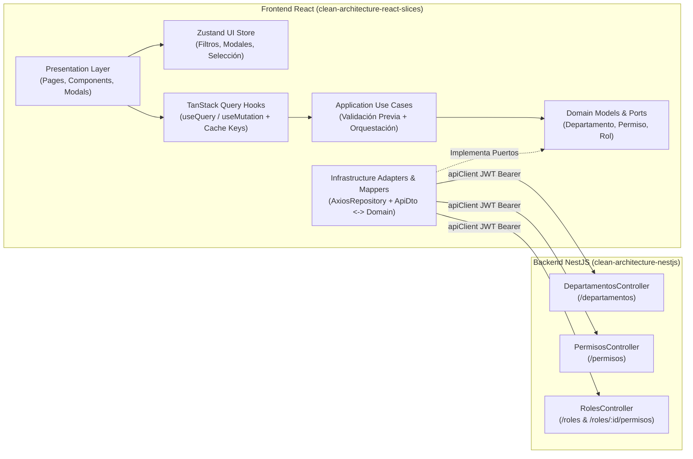

# Plan de Implementación Frontend: Departamentos, Permisos y Roles (RBAC)

Este documento describe la arquitectura y hoja de ruta para implementar en el frontend (`comunicados-plat-front`) los módulos de **Departamentos**, **Permisos** y **Roles**, alineados con el backend NestJS (`comunicados-plat`), la skill `clean-architecture-react-slices` y el sistema de diseño `terra-design-system`.

---

## 1. Arquitectura de Capas (Vertical Slices)

---

## 2. Contratos HTTP del Backend NestJS

### 2.1. Departamentos (`/departamentos`)
- `GET /departamentos` $\rightarrow$ `DepartamentoResponseDto[]` (`{ idDepartamento: string, nombre: string }`)
- `GET /departamentos/:id` $\rightarrow$ `DepartamentoResponseDto`
- `POST /departamentos` (Protegido `JwtAuthGuard`) $\rightarrow$ Body: `{ nombre: string }` (máx. 100 caracteres, normalizado a minúsculas)
- `PATCH /departamentos/:id` (Protegido `JwtAuthGuard`) $\rightarrow$ Body: `{ nombre: string }`
- `DELETE /departamentos/:id` (Protegido `JwtAuthGuard`) $\rightarrow$ `{ message: string }` (retorna `409 Conflict` si tiene usuarios asignados)

### 2.2. Permisos (`/permisos`)
- `GET /permisos` $\rightarrow$ `PermisoResponseDto[]` (`{ idPermiso: string, nombre: string }`)
- `GET /permisos/:id` $\rightarrow$ `PermisoResponseDto`
- `POST /permisos` (Protegido `JwtAuthGuard`) $\rightarrow$ Body: `{ nombre: string }` (máx. 100 caracteres)
- `PATCH /permisos/:id` (Protegido `JwtAuthGuard`) $\rightarrow$ Body: `{ nombre: string }`
- `DELETE /permisos/:id` (Protegido `JwtAuthGuard`) $\rightarrow$ `{ message: string }` (elimina en cascada vínculos en `rol_permiso`)

### 2.3. Roles (`/roles`)
- `GET /roles` $\rightarrow$ `RolResponseDto[]` (`{ idRol: string, nombre: string, permisos: { idPermiso: string, nombre: string }[] }`)
- `GET /roles/:id` $\rightarrow$ `RolResponseDto`
- `POST /roles` (Protegido `JwtAuthGuard`) $\rightarrow$ Body: `{ nombre: string, permisoIds?: string[] }` (nombre máx. 50 caracteres)
- `PATCH /roles/:id` (Protegido `JwtAuthGuard`) $\rightarrow$ Body: `{ nombre: string }`
- `PUT /roles/:id/permisos` (Protegido `JwtAuthGuard`) $\rightarrow$ Body: `{ permisoIds: string[] }` (sincronización atómica de permisos del rol)
- `DELETE /roles/:id` (Protegido `JwtAuthGuard`) $\rightarrow$ `{ message: string }` (retorna `409 Conflict` si tiene usuarios asignados)

---

## 3. Estructura de Directorios en `src/features/`

Cada módulo (`departamentos`, `permisos`, `roles`) tendrá su propio Vertical Slice autocontenido:
- `domain/models/`: Entidades e invariantes puras (`DepartamentoRules`, `PermisoRules`, `RolRules`).
- `domain/ports/`: Interfaces de repositorio (`DepartamentoRepository`, `PermisoRepository`, `RolRepository`).
- `application/dtos/` y `application/use-cases/`: Casos de uso desacoplados para listar, crear, actualizar, eliminar y sincronizar permisos.
- `infrastructure/dtos/`, `infrastructure/mappers/`, `infrastructure/adapters/` y `infrastructure/container.ts`: Adaptadores con `apiClient` (Axios) y mappers explícitos.
- `presentation/hooks/`, `presentation/store/` y `presentation/components/`: Hooks de TanStack Query con invalidación cruzada, stores de UI en Zustand y vistas integradas al Dashboard con tokens TERRA.

