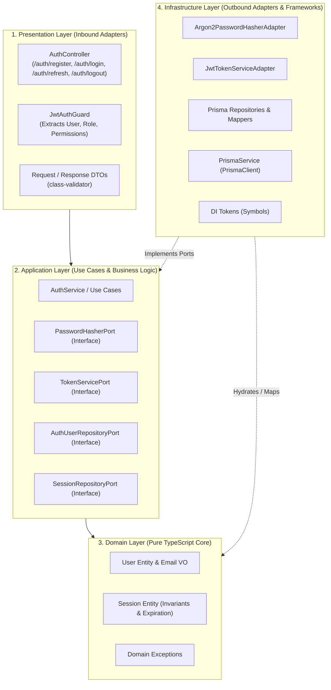

# Plan de Implementación: Autenticación y Persistencia con Clean Architecture en NestJS

Este documento describe la hoja de ruta y la arquitectura técnica implementada para el sistema de base de datos relacional y autenticación segura con sesiones persistentes y rotación de tokens en NestJS, siguiendo los lineamientos de la skill `clean-architecture-nestjs`.

---

## 1. Visión General de la Arquitectura

---

## 2. Modelo de Base de Datos y Entidades

### Entidades y Relaciones

1. **`departamento`**:
   - `id_departamento` (PK, int autoincrement)
   - `nombre` (varchar 100)
2. **`roles`**:
   - `id_rol` (PK, int autoincrement)
   - `nombre` (unique, varchar 50)
3. **`permiso`**:
   - `id_permiso` (PK, int autoincrement)
   - `nombre` (unique, varchar 100)
4. **`rol_permiso`** (Pivote):
   - `id_rol` (FK `roles`, composite PK)
   - `id_permiso` (FK `permiso`, composite PK)
5. **`usuario`**:
   - `id_usuario` (PK, uuid)
   - `nombre` (varchar 150)
   - `correo` (unique, varchar 150)
   - `password` (varchar 255, hash Argon2id)
   - `telefono` (varchar 25, nullable)
   - `id_rol` (FK `roles`, indexado)
   - `id_departamento` (FK `departamento`, indexado)
   - `created_at`, `updated_at` (timestamps)
6. **`sesion`**:
   - `id_sesion` (PK, uuid)
   - `id_usuario` (FK `usuario`, cascade delete, indexado)
   - `refresh_token_hash` (unique, varchar 255, hash SHA-256 del token opaco)
   - `fecha_inicio` (timestamp, default now)
   - `fecha_expiracion` (timestamp, 7 días)
   - `is_revoked` (boolean, default false)
   - `user_agent` (text, nullable)
   - `ip_address` (varchar 45, nullable)

---

## 3. Fases de Ejecución

### Fase 1: Instalación de Dependencias y Configuración Base
- [x] Instalar dependencias de producción:
  - `@prisma/client`
  - `argon2`
  - `@nestjs/jwt`
  - `cookie-parser`
  - `class-validator`
  - `class-transformer`
  - `@nestjs/config`
- [x] Instalar dependencias de desarrollo:
  - `prisma`
  - `@types/cookie-parser`
- [x] Configurar variables de entorno en `.env` y `.env.example`:
  - `DATABASE_URL`
  - `JWT_SECRET`
  - `JWT_EXPIRES_IN=15m`
  - `REFRESH_TOKEN_EXPIRES_DAYS=7`

---

### Fase 2: Configuración de Base de Datos y Prisma
- [x] Configurar `prisma/schema.prisma` respetando convenciones `camelCase` en código y `snake_case` con `@map` y `@@map`.
- [x] Configurar `prisma.config.ts` para datasource URL y migraciones.
- [x] Generar Prisma Client (`npx prisma generate`).
- [x] Configurar el módulo y servicio global de Prisma:
  - `src/shared/infrastructure/prisma/prisma.service.ts`
  - `src/shared/infrastructure/prisma/prisma.module.ts`
- [ ] Ejecutar la migración a base de datos activa: `npx prisma migrate dev --name init_auth` (requiere instancia viva de Postgres).

---

### Fase 3: Capa de Dominio (`src/modules/auth/domain/`)
- [x] Crear entidades puras sin acoplamiento a frameworks u ORMs:
  - `domain/entities/session.entity.ts`: Invariantes de validez, métodos `revoke()` y verificación de expiración.
- [x] Definir puertos de persistencia (interfaces puras):
  - `domain/ports/session.repository.port.ts`
  - `domain/ports/auth-user.repository.port.ts`

---

### Fase 4: Capa de Aplicación (`src/modules/auth/application/`)
- [x] Definir puertos de servicios de aplicación:
  - `application/ports/password-hasher.port.ts` (contrato para hashing con argon2).
  - `application/ports/token-service.port.ts` (contrato para JWT y hashing SHA-256 de tokens opacos).
- [x] Implementar servicio de aplicación `AuthService`:
  - `register(...)`: Valida unicidad, aplica hash Argon2id y persiste usuario.
  - `login(...)`: Compara contraseña con Argon2, genera access token (15 min) y refresh token opaco (7 días), registrando la sesión persistente.
  - `refreshToken(...)`: Valida sesión previa, aplica **rotación de tokens** (revoca la sesión anterior y crea una nueva con nuevo refresh token).
  - `logout(...)`: Marca la sesión como revocada (`is_revoked = true`).

---

### Fase 5: Capa de Infraestructura (`src/modules/auth/infrastructure/`)
- [x] Definir tokens de inyección (`infrastructure/tokens.ts` con `Symbol`):
  - `PASSWORD_HASHER_TOKEN`
  - `TOKEN_SERVICE_TOKEN`
  - `AUTH_USER_REPOSITORY_TOKEN`
  - `SESSION_REPOSITORY_TOKEN`
- [x] Implementar adaptadores concretos:
  - `infrastructure/adapters/argon2-password-hasher.adapter.ts` (Argon2id con memoryCost y timeCost seguros).
  - `infrastructure/adapters/jwt-token-service.adapter.ts` (JWT access token + SHA-256 para el refresh token hash).
- [x] Implementar mappers y repositorios Prisma:
  - `infrastructure/persistence/prisma/session.mapper.ts`
  - `infrastructure/persistence/prisma/session-prisma.repository.ts`
  - `infrastructure/persistence/prisma/auth-user-prisma.repository.ts` (extracción de usuario con rol y lista plana de permisos).

---

### Fase 6: Capa de Presentación (`src/modules/auth/presentation/`)
- [x] DTOs de transporte con validación (`class-validator`):
  - `presentation/dtos/register.request.dto.ts`
  - `presentation/dtos/login.request.dto.ts`
- [x] Controlador `AuthController` (`presentation/controllers/auth.controller.ts`):
  - `POST /auth/register` (HTTP 201)
  - `POST /auth/login` (HTTP 200, emite cookie `HttpOnly`, `SameSite: strict`, `Secure`, `Path: /auth`)
  - `POST /auth/refresh` (HTTP 200, lee cookie, rota tokens y actualiza la cookie)
  - `POST /auth/logout` (HTTP 200, revoca sesión en BD y limpia la cookie con `res.clearCookie`)
- [x] Guard de autenticación (`presentation/guards/jwt-auth.guard.ts`):
  - Extrae `Bearer <token>` del header `Authorization`.
  - Verifica el token JWT con el adaptador.
  - Inyecta `req.user = { sub, correo, rol, permisos }`.

---

### Fase 7: Cableado y Configuración Global
- [x] Crear `src/modules/auth/auth.module.ts`:
  - Importar `PrismaModule` y `JwtModule`.
  - Registrar custom providers con `provide: TOKEN, useClass: Adapter`.
  - Exportar tokens y guards necesarios.
- [x] Configurar `src/main.ts`:
  - Habilitar `cookieParser()`.
  - Habilitar `ValidationPipe({ whitelist: true, forbidNonWhitelisted: true, transform: true })`.
- [x] Importar `ConfigModule`, `PrismaModule` y `AuthModule` en `src/app.module.ts`.

---

## 4. Checklist de Calidad (Skill Clean Architecture)

- [x] **Sin fugas de framework en Dominio:** `domain/` no contiene `@nestjs/*`, decoradores de Prisma ni referencias a Express/HTTP.
- [x] **Inversión de dependencias:** La capa de aplicación solo depende de interfaces (`ports`) y símbolos de inyección (`tokens.ts`).
- [x] **Mapeo explícito:** Ningún modelo generado por Prisma (`prisma.usuario`, `prisma.sesion`) se expone directamente a los casos de uso ni a los controladores.
- [x] **Seguridad de Cookies:** El refresh token nunca se expone en el cuerpo JSON de la respuesta, únicamente en cookies seguras con flags `HttpOnly`, `SameSite`, `Secure` y scope restringido a `/auth`.
- [x] **Testabilidad:** Casos de uso testeados con mocks puros en Vitest (`src/modules/auth/application/services/auth.service.spec.ts`) con 7 pruebas unitarias pasando en 14ms.
